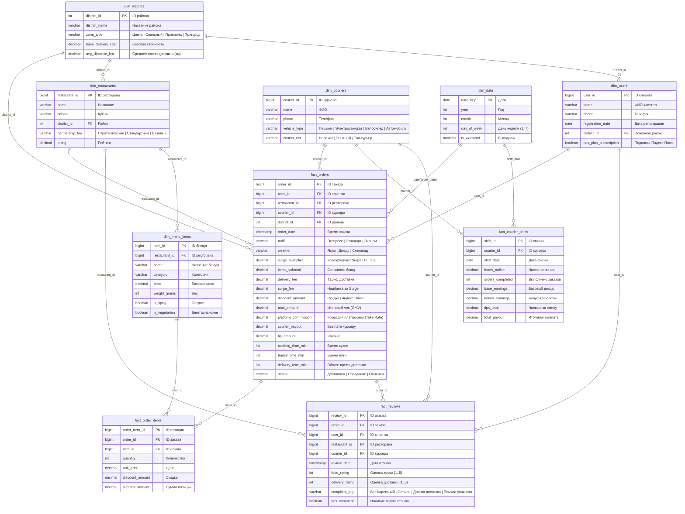

# Паспорт модели: Логистическая платформа «Яндекс Доставка»

## 1. Бизнес-процесс и гранулярность (Зерно фактов)

* **Домен:** Двусторонний маркетплейс и логистическая платформа экспресс-доставки еды из ресторанов и Dark Kitchens клиентам в масштабе мегаполиса (аналог Яндекс Еда / Яндекс Go Доставка).
* **Период данных:** `2025-10-01` — `2026-09-30`.
* **Архитектура:** Fact Constellation Schema (4 таблицы фактов, 6 измерений).
* **Суммарный объём фактов:** **2 373 022 строки**.

### Что означает одна строка в таблицах фактов (Grain):

1. **`fact_orders` (Заказы и логистические поездки):**
   > **Одна строка в `fact_orders` = один оформленный клиентский заказ на доставку** с уникальным `order_id`, фиксированным временем создания, тарифом (`Экспресс`, `Стандарт`, `Эконом`), погодными условиями (`Ясно`, `Дождь`, `Снегопад`), коэффициентом повышенного спроса (`surge_multiplier`), стоимостью блюд, платой за доставку, надбавкой за Surge, скидкой по подписке Яндекс Плюс, итоговым чеком клиента (GMV), комиссией платформы (Take Rate), выплатой курьеру (`courier_payout`), чаевыми, временем готовки рестораном (`cooking_time_min`), временем курьера в пути (`transit_time_min`), общим временем доставки (`delivery_time_min`) и финальным статусом выполнения (`Доставлен`, `Опоздание`, `Отменен`).
   > *Проверка зерна:* `SELECT COUNT(*) = COUNT(DISTINCT order_id) FROM fact_orders;` (600 000 строк).

2. **`fact_order_items` (Товарные позиции чеков / детализация блюд):**
   > **Одна строка в `fact_order_items` = одна позиция конкретного блюда в составе заказа** с уникальным `order_item_id`, ссылкой на родительский `order_id`, позицию меню `item_id`, количеством порций (`quantity`), базовой ценой (`unit_price`), скидкой (`discount_amount`) и итоговой стоимостью позиции (`subtotal_amount`).
   > *Проверка зерна:* `SELECT COUNT(*) = COUNT(DISTINCT order_item_id) FROM fact_order_items;` (1 278 404 строки).

3. **`fact_courier_shifts` (Рабочие смены курьеров в Яндекс Про):**
   > **Одна строка в `fact_courier_shifts` = одна индивидуальная рабочая смена курьера** с уникальным `shift_id`, привязкой к курьеру `courier_id`, датой смены `shift_date`, отработанным временем на линии (`hours_online`), числом закрытых доставок (`orders_completed`), базовым доходом, бонусами за пиковые слоты и суммарным начислением (`total_payout`).
   > *Проверка зерна:* `SELECT COUNT(*) = COUNT(DISTINCT shift_id) FROM fact_courier_shifts;` (144 000 строк).

4. **`fact_reviews` (Оценки и отзывы в приложении):**
   > **Одна строка в `fact_reviews` = один оставленный клиентом отзыв к выполненному заказу** с уникальным `review_id`, оценкой качества блюд (`food_rating` 1..5), оценкой работы курьера (`delivery_rating` 1..5), тегом причины (`complaint_tag`: `Без нареканий`, `Остыло`, `Долгая доставка`, `Помята упаковка`) и признаком комментария.
   > *Проверка зерна:* `SELECT COUNT(*) = COUNT(DISTINCT review_id) FROM fact_reviews;` (350 618 строк).

---

## 2. Схема данных (Fact Constellation Schema)



---

## 3. Таблицы и политика хранения истории (SCD)

| Таблица | Роль в модели | Первичный ключ (PK) | Основные атрибуты | Политика SCD | Обоснование выбора SCD |
| :--- | :--- | :--- | :--- | :--- | :--- |
| **`fact_orders`** | Таблица фактов | `order_id` | `order_date`, `status`, `total_amount`, `surge_multiplier`, `platform_commission`, `courier_payout` | **Append Only** | Событие оформления и исполнения заказа. |
| **`fact_order_items`** | Таблица фактов | `order_item_id` | `quantity`, `unit_price`, `subtotal_amount` | **Append Only** | Товарный состав чека неизменен после покупки. |
| **`fact_courier_shifts`**| Таблица фактов | `shift_id` | `hours_online`, `orders_completed`, `total_payout` | **Append Only** | Фиксация закрытой рабочей смены в Яндекс Про. |
| **`fact_reviews`** | Таблица фактов | `review_id` | `food_rating`, `delivery_rating`, `complaint_tag` | **Append Only** | Оценка клиента на момент доставки. |
| **`dim_couriers`** | Измерение | `courier_id` | `name`, `vehicle_type`, `courier_tier` | **SCD2 (храним историю)** | **Реализовано на З06 (см. [scd2.md](scd2.md)):** Курьер меняет транспорт и грейд в Яндекс Про (`Пешком / Новичок` $\to$ `Электросамокат / Опытный` $\to$ `Автомобиль / Топ-курьер`). При затирании старого значения (SCD1) исказится ретроспективный анализ скорости и SLA. |
| **`dim_menu_items`** | Измерение | `item_id` | `name`, `category`, `price`, `weight_grams` | **SCD1** | Базовая цена меню затирается, фактическая историческая цена продажи зафиксирована в факте чека `fact_order_items.unit_price`. |
| **`dim_restaurants`** | Измерение | `restaurant_id` | `name`, `cuisine`, `partnership_tier`, `rating` | **SCD1** | Смена уровня комиссии или рейтинга перезаписывается поверх. |
| **`dim_users`** | Измерение | `user_id` | `name`, `phone`, `has_plus_subscription` | **SCD1** | Смена номера телефона или статуса подписки. |
| **`dim_districts`** | Измерение | `district_id` | `district_name`, `zone_type`, `base_delivery_cost` | **SCD1** | Корректировка границ и тарифов зоны. |
| **`dim_date`** | Измерение | `date_key` | `year`, `month`, `day_of_week`, `is_weekend` | **Статичный (SCD0)** | Календарная сетка постоянна. |

---

## 4. Меры (Метрики) и правила их агрегации

| Мера / Поле | Тип агрегации | Можно ли просто `SUM`? | Описание и формула расчёта |
| :--- | :--- | :---: | :--- |
| **Выручка по доставленным заказам (Net GMV)** | Аддитивная | **Да** | `SUM(total_amount) WHERE status IN ('Доставлен', 'Опоздание')`. Главная бизнес-метрика товарооборота. |
| **Комиссионная выручка Яндекса (Platform Commission)**| Аддитивная | **Да** | `SUM(platform_commission)` — чистая комиссия маркетплейса с ресторанов (Take Rate 18..28%). |
| **Выручка за логистику (Delivery Revenue)** | Аддитивная | **Да** | `SUM(delivery_fee + surge_fee)` — суммарная оплата клиентами доставки и надбавок за Surge. |
| **Выплаты курьерам (Courier Payouts)** | Аддитивная | **Да** | `SUM(courier_payout)` — фонд оплаты труда курьеров платформы. |
| **Чистая операционная маржа (Platform Net Margin)** | Аддитивная | **Да** | `SUM(platform_commission + delivery_fee + surge_fee - courier_payout)`. |
| **Чаевые курьерам (Tips Volume)** | Аддитивная | **Да** | `SUM(tip_amount)` в заказах и `SUM(tips_total)` в сменах. |
| **Количество заказов (Orders Count)** | Аддитивная | **Да** (`COUNT`) | `COUNT(order_id)`. |
| **Отработано часов на линии (Hours Online)** | Аддитивная | **Да** | `SUM(hours_online)` в `fact_courier_shifts`. |
| **Средний коэффициент повышенного спроса (Avg Surge)**| Неаддитивная | **Нет** | `AVG(surge_multiplier)` (1.00..2.20). |
| **Среднее время кухни (Avg Cooking Time)** | Неаддитивная | **Нет** | `AVG(cooking_time_min)`. |
| **Среднее время курьера в пути (Avg Transit Time)** | Неаддитивная | **Нет** | `AVG(transit_time_min)`. |
| **Доля опозданий (Late Delivery Rate, %)** | Неаддитивная | **Нет** | `COUNT(*) FILTER (WHERE status = 'Опоздание') * 100.0 / COUNT(*)`. |
| **Производительность курьера (Orders per Hour)** | Неаддитивная | **Нет** | `SUM(orders_completed) / SUM(hours_online)`. |

---

## 5. Главная метрика проекта

- **Название:** Выручка по выполненным заказам (**Net GMV** / Оборот доставленных заказов).
- **Бизнес-смысл:** Совокупный объём платежей клиентов за успешно доставленные заказы.
- **Зафиксированное эталонное значение на датасете:** **`27 399 331.21 BYN`** (по **`539 801`** выполненным заказам: 509 780 доставлено в срок + 30 021 с опозданием; 60 199 отмен; комиссионная выручка Яндекса: `5 499 204.05 BYN`; выплаты курьерам: `4 876 167.06 BYN`).
- **Эталонный SQL (`sql/canonical_metric.sql`):**

```sql
SELECT
    COUNT(order_id)   AS delivered_orders_cnt,
    SUM(total_amount) AS net_gmv_byn
FROM fact_orders
WHERE status IN ('Доставлен', 'Опоздание');
```

---

## 6. Три аналитических вопроса к витрине (для З04)

1. **Юнит-экономика платформы и Take Rate комиссии Яндекса по кухням в динамике:**
   *«Каков валовой товарооборот (GMV), комиссионная выручка Яндекса (platform_commission), выплаты курьерам и чистая операционная прибыль платформы в разрезе типов кухонь помесячно, а также доля комиссии каждой кухни в ежемесячной прибыли (`SUM() OVER (PARTITION BY order_month)`) и ранг кухни по выручке (`DENSE_RANK()`)?»*
2. **Динамическое ценообразование Surge, погодные аномалии и SLA доставки:**
   *«Как погодные условия (`weather`: Ясно, Дождь, Снегопад) и тариф доставки (`tariff`: Экспресс, Стандарт, Эконом) влияют на средний коэффициент повышенного спроса (`surge_multiplier`), надбавку за Surge (`surge_fee`), среднее время доставки и процент опозданий (>60 минут) в часы пик против обычных часов?»*
3. **Логистическая выработка курьеров и утилизация смен в Яндекс Про:**
   *«Какова средняя выработка курьеров за смену (заказов в час: `orders_completed / hours_online`), средний часовой заработок (`total_payout / hours_online`) и структура бонусов в разрезе типов транспорта (`vehicle_type`) и грейдов (`courier_tier`: Топ-курьер, Опытный, Новичок), а также рейтинг доходности грейдов через оконную функцию `RANK() OVER (ORDER BY avg_hourly_payout_byn DESC)`?»*
