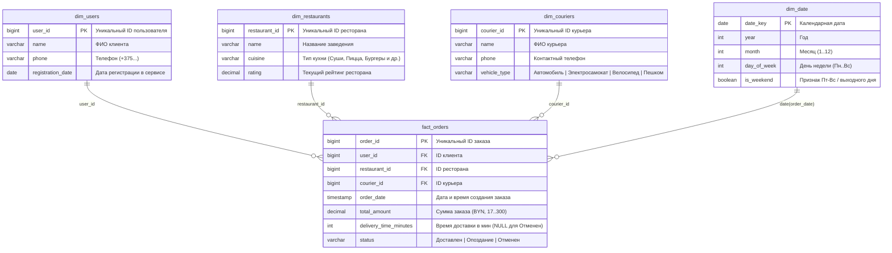

# Паспорт модели: Доставка еды

## 1. Бизнес-процесс и гранулярность (Зерно факта)

* **Домен:** Сервис экспресс-доставки готовой еды из ресторанов.
* **Период данных:** `2025-10-01` — `2026-09-30` (1 000 000 событий).
* **Что означает одна строка факта (Grain):**
  > **Одна строка в `fact_orders` = один оформленный клиентский заказ в сервисе доставки еды** (с уникальным `order_id`, фиксированным временем оформления, итоговой суммой чека, назначенным курьером, выбранным рестораном и финальным статусом выполнения).

* **Проверка гранулярности:** `SELECT COUNT(*) = COUNT(DISTINCT order_id) FROM fact_orders;` (должно возвращать `TRUE`). Позиции внутри чека (блюда) в рамках данной витрины агрегированы до уровня всего заказа.

---

## 2. Схема данных (Star Schema)

В центре находится таблица фактов `fact_orders`, окружённая тремя бизнес-измерениями (`dim_users`, `dim_restaurants`, `dim_couriers`) и календарным измерением времени (`dim_date` / `order_date`).



---

## 3. Таблицы и политика хранения истории (SCD)

| Таблица | Роль в модели | Первичный ключ (PK) | Основные атрибуты (разрезы) | Политика истории (SCD) | Обоснование выбора SCD |
| :--- | :--- | :--- | :--- | :--- | :--- |
| **`fact_orders`** | Таблица фактов | `order_id` | `order_date`, `status` (`Доставлен`, `Опоздание`, `Отменен`) | **Append / Итоговый снимок** | Строка фиксирует финальное состояние заказа. |
| **`dim_couriers`** | Измерение (Справочник) | `courier_id` | `name`, `phone`, `vehicle_type` | **SCD2 (храним историю)** | **Кандидат на З06:** Курьер может сменить тип транспорта (например, пересесть с `Пешком` на `Электросамокат` или `Автомобиль`). Если затереть старое значение (SCD1), исторический анализ времени доставки по типам транспорта исказится. |
| **`dim_restaurants`** | Измерение (Справочник) | `restaurant_id` | `name`, `cuisine`, `rating` | **SCD1 (затираем старое)** | Смена вывески или корректировка текущего рейтинга перезаписывается поверх старого значения. |
| **`dim_users`** | Измерение (Справочник) | `user_id` | `name`, `phone`, `registration_date` | **SCD1 (затираем старое)** | Дата регистрации неизменна, а при смене номера телефона или опечатке в ФИО старые данные хранить не требуется. |
| **`dim_date`** | Измерение (Календарь) | `date_key` | `year`, `month`, `day_of_week`, `is_weekend` | **Статичный (SCD0)** | Календарная сетка не меняется со временем. |

---

## 4. Меры (Метрики) и правила их агрегации

| Мера / Поле | Тип агрегации | Можно ли просто `SUM`? | Описание и формула расчёта |
| :--- | :--- | :---: | :--- |
| **Выручка по выполненным заказам (Net GMV)** | Аддитивная | **Да** | `SUM(total_amount) WHERE status IN ('Доставлен', 'Опоздание')`. Главная метрика бизнеса. |
| **Валовой объём заказов (Gross GMV)** | Аддитивная | **Да** | `SUM(total_amount)` по всем статусам (включая отменённые). |
| **Потери от отмен (Cancelled Volume)** | Аддитивная | **Да** | `SUM(total_amount) WHERE status = 'Отменен'`. |
| **Количество заказов (Orders Count)** | Аддитивная | **Да** (`COUNT`) | `COUNT(order_id)` — общее число событий. |
| **Средний чек (AOV)** | Неаддитивная | **Нет** | Складывать средние чеки по дням или кухням нельзя. Только отношение: `SUM(total_amount) / COUNT(order_id)`. |
| **Среднее время доставки (Avg Delivery Time)** | Неаддитивная | **Нет** | `AVG(delivery_time_minutes)` (у `Отменен` значение `NULL`, в среднее они не попадают). Суммировать минуты бессмысленно. |
| **Доля опозданий (Late Delivery Rate, %)** | Неаддитивная | **Нет** | `COUNT(*) FILTER (WHERE status = 'Опоздание') * 100.0 / COUNT(*) FILTER (WHERE status != 'Отменен')`. |
| **Уникальные активные клиенты (MAU / DAU)** | Неаддитивная | **Нет** (`COUNT DISTINCT`) | `COUNT(DISTINCT user_id)` — нельзя суммировать по месяцам или типам кухни (один клиент заказывает в разные дни и в разных ресторанах). |

---

## 5. Главная метрика проекта

* **Название:** Выручка по доставленным заказам (**Net GMV** / Оборот без учёта отмен).
* **Бизнес-смысл:** Отражает реальный денежный поток от успешно выполненных доставок (включая те, где курьер опоздал, но заказ был вручён и оплачен клиентом, и исключая отменённые заказы со статусом `Отменен`).
* **Черновик эталонного SQL:**

```sql
SELECT
    DATE_TRUNC('month', order_date) AS order_month,
    SUM(total_amount)               AS net_gmv
FROM fact_orders
WHERE status IN ('Доставлен', 'Опоздание')
GROUP BY 1
ORDER BY 1;
```

---

## 6. Три аналитических вопроса к витрине (для З04)

1. **Выручка и средний чек по кухням в динамике:**
   *«Какова чистая выручка (Net GMV), количество заказов и средний чек в разрезе типов кухонь (`cuisine`) помесячно за весь период с октября 2025 по сентябрь 2026?»*
2. **Операционная эффективность транспорта и SLA доставки:**
   *«Каково среднее время доставки (`delivery_time_minutes`) и доля опозданий (`status = 'Опоздание'`, доставка дольше 60 минут) в разрезе типа транспорта курьера (`vehicle_type`) в часы пик (обед 12:00–13:59 и ужин 18:00–19:59) против остальных часов?»*
3. **Когортная активность и вклад выходных дней:**
   *«Насколько выше оборот и среднее число заказов в пятницу–воскресенье по сравнению с буднями (Пн–Чт), и какую долю выручки приносят ранние пользователи (зарегистрированные до `2025-10-01`) против новых когорт?»*