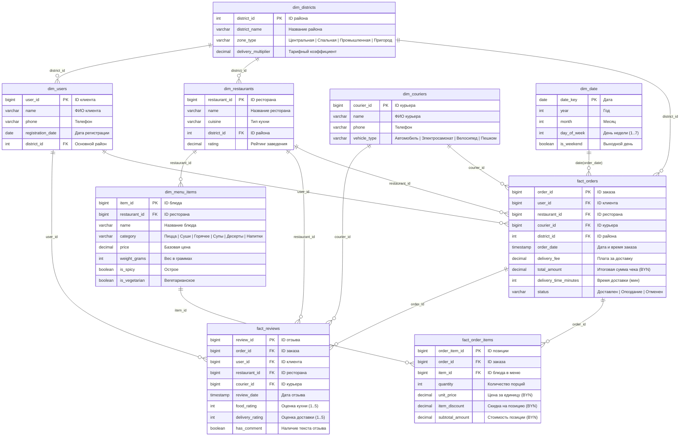

# Паспорт модели: Сервис доставки еды

## 1. Бизнес-процесс и гранулярность (Зерно фактов)

* **Домен:** Сервис экспресс-доставки готовой еды из ресторанов клиентам по районам города.
* **Период данных:** `2025-10-01` — `2026-09-30`.
* **Архитектура:** Fact Constellation Schema (Созвездие фактов с общими справочниками).
* **Суммарный объём фактов:** **4 186 869 строк**.

### Что означает одна строка в таблицах фактов (Grain):

1. **`fact_orders` (Заказы):**
   > **Одна строка в `fact_orders` = один оформленный клиентский заказ (чек)** с уникальным `order_id`, фиксированным временем создания, назначенной стоимостью доставки, итоговой суммой заказа, назначенным курьером, выбранным рестораном, целевым районом города и финальным статусом выполнения (`Доставлен`, `Опоздание`, `Отменен`).
   > *Проверка зерна:* `SELECT COUNT(*) = COUNT(DISTINCT order_id) FROM fact_orders;` (1 000 000 строк).

2. **`fact_order_items` (Товарные позиции чеков / детализация блюд):**
   > **Одна строка в `fact_order_items` = одна позиция конкретного блюда в составе заказа** с уникальным `order_item_id`, ссылкой на родительский `order_id`, позицию меню `item_id`, количеством порций (`quantity`), ценой за единицу (`unit_price`), применённой скидкой (`item_discount`) и суммой позиции (`subtotal_amount`).
   > *Связь с родительским чеком:* сумма позиций чека + стоимость доставки равна сумме заказа: `SUM(subtotal_amount) + delivery_fee = total_amount`. (2 601 720 строк).

3. **`fact_reviews` (Оценки и отзывы клиентов):**
   > **Одна строка в `fact_reviews` = один оставленный клиентом отзыв к выполненному заказу** с оценкой блюд (`food_rating` 1..5), оценкой работы курьера (`delivery_rating` 1..5) и признаком текстового комментария (`has_comment`). (585 149 строк).

---

## 2. Схема данных (Fact Constellation Schema)



---

## 3. Таблицы и политика хранения истории (SCD)

| Таблица | Роль в модели | Первичный ключ (PK) | Основные атрибуты | Политика SCD | Обоснование выбора SCD |
| :--- | :--- | :--- | :--- | :--- | :--- |
| **`fact_orders`** | Таблица фактов | `order_id` | `order_date`, `status`, `total_amount`, `delivery_time_minutes` | **Append Only** | Событие оформления и исполнения заказа. |
| **`fact_order_items`** | Таблица фактов | `order_item_id` | `quantity`, `unit_price`, `subtotal_amount` | **Append Only** | Товарный состав чека неизменен после оплаты. |
| **`fact_reviews`** | Таблица фактов | `review_id` | `food_rating`, `delivery_rating`, `has_comment` | **Append Only** | Отзыв клиента фиксирует оценку на момент доставки. |
| **`dim_couriers`** | Измерение | `courier_id` | `name`, `phone`, `vehicle_type` | **SCD2 (храним историю)** | **Кандидат на З06:** Курьер меняет транспорт (`Пешком` $\to$ `Электросамокат` $\to$ `Автомобиль`). При затирании старого значения (SCD1) исторический анализ SLA и скорости доставки исказится. |
| **`dim_menu_items`** | Измерение | `item_id` | `name`, `category`, `price`, `weight_grams` | **SCD1 / SCD2** | Изменение базовой цены в меню затирается (SCD1), так как историческая фактическая цена продажи зафиксирована в факте `fact_order_items.unit_price`. |
| **`dim_restaurants`** | Измерение | `restaurant_id` | `name`, `cuisine`, `district_id`, `rating` | **SCD1 (затираем старое)** | Смена вывески или пересчёт текущего рейтинга перезаписывается поверх. |
| **`dim_users`** | Измерение | `user_id` | `name`, `phone`, `registration_date`, `district_id` | **SCD1 (затираем старое)** | Обновление номера телефона или района проживания. |
| **`dim_districts`** | Измерение | `district_id` | `district_name`, `zone_type`, `delivery_multiplier` | **SCD1 (затираем старое)** | Корректировка границ или коэффициентов зоны. |
| **`dim_date`** | Измерение | `date_key` | `year`, `month`, `day_of_week`, `is_weekend` | **Статичный (SCD0)** | Календарная сетка постоянна. |

---

## 4. Меры (Метрики) и правила их агрегации

| Мера / Поле | Тип агрегации | Можно ли просто `SUM`? | Описание и формула расчёта |
| :--- | :--- | :---: | :--- |
| **Выручка по доставленным заказам (Net GMV)** | Аддитивная | **Да** | `SUM(total_amount) WHERE status IN ('Доставлен', 'Опоздание')`. Главная бизнес-метрика. |
| **Валовой объём заказов (Gross GMV)** | Аддитивная | **Да** | `SUM(total_amount)` по всем созданным заказам. |
| **Товарная выручка от блюд (Items Revenue)** | Аддитивная | **Да** | `SUM(subtotal_amount)` в таблице `fact_order_items`. |
| **Выручка за доставку (Delivery Revenue)** | Аддитивная | **Да** | `SUM(delivery_fee) WHERE status != 'Отменен'`. |
| **Количество проданных порций (Portions Qty)** | Аддитивная | **Да** | `SUM(quantity)` в таблице `fact_order_items`. |
| **Количество заказов (Orders Count)** | Аддитивная | **Да** (`COUNT`) | `COUNT(order_id)`. |
| **Количество отзывов (Reviews Count)** | Аддитивная | **Да** (`COUNT`) | `COUNT(review_id)` в `fact_reviews`. |
| **Средний чек заказа (AOV)** | Неаддитивная | **Нет** | `SUM(total_amount) / COUNT(order_id)`. |
| **Среднее время доставки (Avg Delivery Time)** | Неаддитивная | **Нет** | `AVG(delivery_time_minutes)`. |
| **Доля опозданий (Late Delivery Rate, %)** | Неаддитивная | **Нет** | `COUNT(*) FILTER (WHERE status = 'Опоздание') * 100.0 / COUNT(*)`. |
| **Средний рейтинг блюд (Avg Food Rating)** | Неаддитивная | **Нет** | `AVG(food_rating)` в `fact_reviews` (1.00..5.00). |
| **Средний рейтинг курьера (Avg Delivery Rating)**| Неаддитивная | **Нет** | `AVG(delivery_rating)` в `fact_reviews` (1.00..5.00). |
| **Уникальные активные клиенты (MAU / DAU)** | Неаддитивная | **Нет** (`COUNT DISTINCT`) | `COUNT(DISTINCT user_id)`. |

---

## 5. Главная метрика проекта

- **Название:** Выручка по выполненным заказам (**Net GMV** / Оборот без учёта отмен).
- **Бизнес-смысл:** Реальный денежный поток компании от завершённых доставок.
- **Зафиксированное эталонное значение на датасете:** **`54 595 838.25 BYN`** (по **`899 763`** выполненным заказам: 849 845 доставлено в срок + 49 918 с опозданием; отменено: 100 237 заказов; валовой оборот Gross GMV: `60 648 870.64 BYN`).
- **Эталонный SQL (`sql/canonical_metric.sql`):**

```sql
SELECT
    COUNT(order_id)   AS delivered_orders_cnt,
    SUM(total_amount) AS net_gmv_byn
FROM fact_orders
WHERE status IN ('Доставлен', 'Опоздание');
```

---

## 6. Три аналитических вопроса к витрине (для З04)

1. **Товарная аналитика и структура спроса по категориям блюд:**
   *«Какие категории блюд (`category`: Пицца, Суши, Горячее, Супы, Десерты...) приносят наибольшую выручку, каков объём проданных порций, средняя цена блюда, а также доля выручки каждой категории внутри каждого месяца с ранжированием категорий по доле продаж (`DENSE_RANK()`)?»*
2. **Операционная эффективность транспорта, SLA и клиентская оценка:**
   *«Каково среднее время доставки, процент опозданий (>60 мин) и средняя клиентская оценка курьера (`delivery_rating` из `fact_reviews`) в разрезе видов транспорта курьера (`vehicle_type`) в часы пик (12:00–13:59 и 18:00–19:59) против остальных часов?»*
3. **Географическая сегментация районов и рейтинг качества еды:**
   *«Каков объём выручки (Net GMV), средний чек заказа, средняя стоимость доставки (`delivery_fee`) и средняя оценка качества блюд (`food_rating`) по районам города (`district_name`, `zone_type`), а также доля каждого района в общегородском обороте?»*
